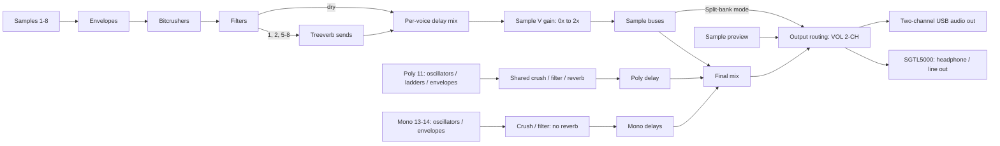

# Audio graph

The Teensy Audio design lives in [`audioinit.h`](https://github.com/Soundpauli/toern/blob/main/audioinit.h): object declarations plus `AudioConnection` patch cords. Open it like a schematic.

## High-level signal flow

Exact node names differ per channel (`sound1`, `envelope1`, `bitcrusher1`, … and synth-side `Swaveform*`, `Senvelope*`, `Sladder*`).

## USB audio output

The build enables `USB_MIDI_AUDIO_SERIAL`. `AudioOutputUSB usb1` receives `mixer_stereoR` on USB channel 0 and `mixer_stereoL` on channel 1, matching the I2S output connections. USB audio therefore follows `VOL → 2-CH`, including the main/preview and split-bank modes. Connect USB-C to a computer and select the device as a two-channel recording input. No USB audio input is connected to the sampler.

## Mix gain and peak protection

Sample banks (`mixer1/2`), the synth bus, `mixer_end` and the headphone/USB route mixers use `AudioMixer4Limited`. Four float inputs are summed before conversion to 16-bit PCM; a 16-sample lookahead limiter keeps peaks at or below 32700, with 50 ms recovery. Input gains are not clipped separately, so signed cancellation remains valid. Default sample-bank and final sample gains are now 1.0 instead of 1/3 and 1/2. A lone sample therefore retains its level through these stages; velocity, channel volume, sample V gain and effects still apply. Synth final gain changes from 0.6 to 3.6, retaining the sample/synth balance below limiting.

Each limited mixer adds 16 samples (0.36 ms at 44.1 kHz). The normal bank → main → route path adds three windows, about 1.09 ms; split-bank output adds two, about 0.73 ms. Limiting can change the balance when a bank or final sum overloads. It cannot undo clipping already produced inside a voice or an effect before these mixers. `tests/test_audio_gain.py` exercises the actual mixer, four hits per bank, both banks plus synths/monitor/preview, gain boosts, polarity cancellation, recovery and dry/filter transitions.

## Why some objects are `EXTMEM`

Large Audio objects and mixers are annotated `EXTMEM` so their state lives in PSRAM. That is a deliberate RAM1 conservation strategy — see [Memory](../contributing/memory).

## Custom nodes in `src/`

| Component | Why it exists |
|-----------|----------------|
| `resamplerReader.h` | Variable-rate / interpolated playback; TIME stretch control into WSOLA |
| `toern_wsola.h` | RAM-source WSOLA for independent time-stretch (filter page 1 TIME) |
| `effect_treeverb` | Full-rate light reverb: four combs and two diffusers per object, buffers in RAM1 |

`toern.ino` includes `src/effect_treeverb.h` and sets `FASTLED_ALLOW_INTERRUPTS 0` so LED updates don’t fight the audio ISR world.

## Changing the graph

1. Edit objects/connections in `audioinit.h` (Arduino Audio System Design Tool exports are a common starting point).
2. Update any pointers/arrays in filter/synth code that assume channel → object mapping.
3. Revisit mixer gain constants (`GAIN_*`, `MIX_*`) so summed voices don’t clip.
4. Test with multiple simultaneous sample hits + synths — headroom bugs show up under load, not silence.
