# Tools overview

Besides the firmware and PCB, the repo ships **browser and CLI tools** for samples, patterns, SD files, firmware flashing, and docs imagery.

## Public / hosted

| Tool | URL | Source |
|------|-----|--------|
| Sample converter | [audioconvert.tyng.app](https://audioconvert.tyng.app/) | `tools/audioconvert/` |
| SD tool | [sdtool.tyng.app](https://sdtool.tyng.app/) | `tools/sdtool/` |
| Browser simulator | [sim.tyng.app](https://sim.tyng.app/) | `tools/sim/` |
| Firmware tool | [firmware.tyng.app](https://firmware.tyng.app/) | `tools/firmware/` (GPL-3.0) |
| Color scheme editor | [toern.live/tools/colorsheme/](https://toern.live/tools/colorsheme/) | `tools/colorsheme/` |
| Case generator (demo) | `case.toern.live` (planned; not deployed) | `tools/case/` |

## Local / contributor helpers

| Tool | Path | Role |
|------|------|------|
| SD CLI | `tools/sdtool/toern_sd.py` | Scripted list/put/get over USB serial |
| [MCP remote](./mcp-remote) | `tools/toern-mcp/` | Serial panel control, JSON state/menus/filters, matrix capture and performance telemetry |

## How they relate to the device

```mermaid
flowchart LR
  WAV[WAVs / ZIPs] --> CONV[Sample converter]
  CONV --> SD[microSD layout]
  MID[MIDI file] --> SIM[Simulator]
  HOST[Browser / CLI] --> SDTOOL[SD tool]
  SDTOOL -->|USB serial| TEENSY[Teensy]
  HEX[.hex firmware] --> LOADER[Firmware tool]
  LOADER -->|WebHID| TEENSY
```



Operator-facing how-to stays in the **handbook**; these pages describe **what each tool is, where the code lives, and how to run or extend it**.

## Next

- [Sample converter](./sample-converter)
- [SD tool](./sd-tool)
- [MCP remote](./mcp-remote)
- [Firmware loader](./firmware-loader)
- [Color scheme editor](./color-scheme)

## Shared visual design

The firmware tool, sample converter and both SD browser views use `tools/_shared/tool-theme.css`: the website’s grey backgrounds, white surfaces, red actions and TŒRN font family (Bebas Neue, Space Grotesk, Inter, JetBrains Mono). Each independently hosted tool includes its own copy so it does not depend on the website’s CSS.

After editing the canonical theme, run from the repository root:

```bash
python3 tools/_shared/sync-tool-theme.py
```

Page-specific styles retain their functional layout. Keep input IDs and event bindings stable when changing presentation. The simulator approximates device audio/timing; its transfer feature does not transfer complete KIT sounds. See [Browser simulator](./simulator).
